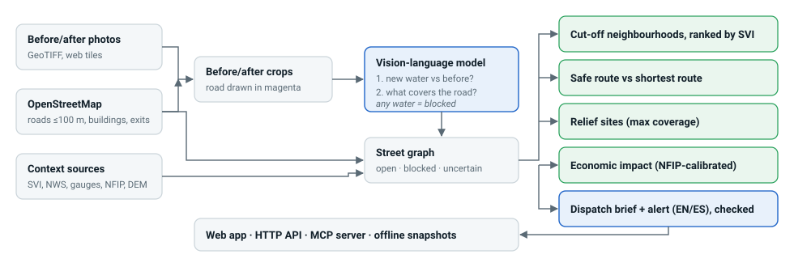

# FloodLens

FloodLens finds the streets that became islands after a flood. It compares aerial photos taken before and after the event, road by road, with a vision-language model. From those judgements it builds a passability map of the street network and finds the neighbourhoods with no dry road out. It then plans safe routes, recommends sites for relief points and estimates the damage to homes.

The repository contains a Python pipeline that prepares each area, a FastAPI backend, a MapLibre web interface and an MCP server.



## Contents

- [How it works](#how-it-works)
- [Areas](#areas)
- [Repository layout](#repository-layout)
- [Setup](#setup)
- [Running the pipeline](#running-the-pipeline)
- [Web app](#web-app)
- [HTTP API](#http-api)
- [MCP server](#mcp-server)
- [Configuration](#configuration)
- [Working offline](#working-offline)
- [Evaluation](#evaluation)
- [Data sources](#data-sources)
- [Licence](#licence)

## How it works

1. **Imagery.** Each source photo covers exactly one web-map tile and comes with WGS84 bounds on a Web Mercator grid. The pipeline writes every photo to a GeoTIFF (EPSG:3857) and cuts an XYZ tile pyramid for the map.
2. **Roads, buildings, facilities.** OpenStreetMap data is fetched for the photographed area plus a 150 m margin. Roads are split into pieces of at most 100 m. Nodes outside the photographed area are the exits.
3. **Road judgement.** For every road piece the pipeline cuts a before and an after crop with the road drawn in magenta. The model answers two questions. The first compares the crops: is there new water on the road? The second looks at the after crop alone: what covers the road surface? Any "water" answer marks the road blocked. A road is open only when both answers describe a dry road. Everything else is uncertain and goes to the review queue.
4. **Cut-off neighbourhoods.** Blocked roads are removed from the graph. Connected parts of the network with no hospital, shelter or exit are cut off, provided at least one flooded road borders them. Each is ranked by estimated population and tract-level social vulnerability (CDC SVI). Two views are kept: *best estimate* (unseen roads passable with a penalty) and *confirmed only* (only roads judged open).
5. **Routing.** The safest route from any point to a shelter, hospital or exit avoids blocked roads and penalises uncertain ones. It is shown next to the plain shortest route and the flooded roads that route would cross.
6. **Context.** Census vulnerability, NWS warnings issued during the event, NOAA storm reports, river gauges, elevation and live NWS alerts. Every source returns a status envelope (`live`, `cached`, `snapshot`, `unavailable`) and falls back to a saved snapshot.
7. **Dispatch brief.** The chat model drafts a short brief and a resident alert in English or Spanish from structured facts only. Every number in the output is checked against those facts. Numbers that are not found are struck through.
8. **Relief sites.** Open areas of at least 1,500 m² are checked by the model on before and after crops. They are then filtered for road access, truck access over confirmed-dry roads and relative elevation. A greedy maximum-coverage step picks the sites that serve the most vulnerability-weighted residents within 1.5 km.
9. **Economic impact.** A fixed-seed random sample of homes is checked for floodwater. Damage ratios per class come from NFIP claims for the same event (building damage / building value by exterior water depth). Home values come from the ACS 2016 median value of each census tract. Totals are scaled to every home in the area and reported with a bootstrap range.

## Areas

Areas are defined in `config.yaml`.

| Id | Area | Event | Mode |
|---|---|---|---|
| `west_houston` | Addicks and Barker, Bear Creek, Eldridge | Hurricane Harvey, 30 Aug 2017 | before/after pairs |
| `richmond` | Richmond and Rosenberg, Brazos River | Hurricane Harvey, 31 Aug 2017 | before/after pairs |
| `kingwood` | Kingwood and Forest Cove, San Jacinto River | Hurricane Harvey, 31 Aug 2017 | before/after pairs |
| `bevil_oaks` | Bevil Oaks, Pine Island Bayou | Hurricane Harvey, 1 Sep 2017 | before/after pairs |
| `simonton` | Simonton, Brazos River | Hurricane Harvey, 3 Sep 2017 | before/after pairs |
| `hill_country` | Hunt, Ingram, Kerrville, Center Point, Comfort | Guadalupe River flood, July 2025 | after photo only |
| `san_antonio` | 156 low-water crossings, 1 km around each | Heavy-rain scenario | no photos: every crossing closed |

In after-only areas the road check uses the surface question alone. The San Antonio area has no photos. It closes every low-water crossing and shows which neighbourhoods can only leave across one.

## Repository layout

```
floodlens/
  cli.py          command-line entry point (python -m floodlens <command>)
  config.py       config.yaml + .env, per-area paths
  data.py         image metadata, per-area tile selection, downloads, data checks
  imagery.py      PNG -> GeoTIFF, tile index for crops, web tile pyramid
  osm.py          street graph, road pieces, buildings, facilities, exits, Overpass retries
  roads.py        road crops, two-question model check, decision rule
  analysis.py     edge status, population and SVI per building, cut-off zones, routing
  sources.py      context sources with status envelope, snapshots and fault injection
  impact.py       building sample check, home values, NFIP calibration, farmland
  relief.py       relief site candidates, checks, need, maximum coverage
  brief.py        dispatch brief and alert with number checking
  evaluate.py     baselines, controls, hand-label metrics
  sa.py           San Antonio crossings, SmartSA sensors, scenario
  polychips.py    before/after crops around polygons
  api.py          FastAPI app
  vlm/            OpenAI-compatible client with cache and retries, prompts, mock
web/              index.html, app.js, styles.css, vendored MapLibre GL JS
mcp_servers/      floodlens_mcp.py
scripts/          run_all_areas.sh
tests/            unit tests (no network, no model)
docs/             DECISIONS.md, EVALUATION.md
eval/labels/      hand labels written by the review screen
ops/              RUNLOG.md and error reports written by the CLI
config.yaml       areas, events and thresholds
environment.yml   conda-forge environment
```

Generated data lives in `data/` and is not tracked.

```
data/raw/        source photos and metadata, context snapshots
data/geotiff/    one GeoTIFF per photo
data/tiles/      XYZ map tiles per area
data/derived/    per-area GeoJSON layers, graph, summaries
data/chips/      before/after crops for roads, buildings, fields and sites
data/cache/      model responses (keyed by image bytes, prompt and model), OSM cache
```

## Setup

The environment is built from conda-forge.

```sh
conda env create -f environment.yml        # or: micromamba create -f environment.yml
conda activate floodlens
cp .env.example .env                       # set VLM_BASE_URL, VLM_MODEL, VLM_API_KEY
python -m pytest -q                        # unit tests
```

`VLM_BASE_URL` must point to an OpenAI-compatible endpoint that serves a vision-language model (tested with Qwen3-VL-8B-Instruct). With `VLM_MOCK=1` every model call returns deterministic placeholder labels, so the pipeline and the UI run without a model.

## Running the pipeline

Every command takes `--area <id>` or `--area all`.

| Command | What it does |
|---|---|
| `fetch-data` | Downloads the metadata and the photos of the area |
| `check-data` | Checks row and column counts, reciprocal pairs and that every downloaded image decodes |
| `imagery` | Writes GeoTIFFs and cuts the web tile pyramid |
| `prepare` | Fetches OSM data and builds road pieces, buildings, facilities and exits |
| `chips` | Cuts before/after crops for every road piece |
| `vlm-check` | Asks one question about a full tile and times the road check |
| `label` | Runs the road check on every pending road piece (cached) |
| `fetch-context` | Downloads SVI, tracts, NWS warnings, storm reports, gauges, elevation and county data |
| `analyze` | Computes edge status, cut-off neighbourhoods, priority ranks and facility reachability |
| `impact` | Runs the economic impact estimate |
| `relief` | Runs the relief site recommender |
| `prefetch-briefs` | Writes and saves briefs in English and Spanish for the top neighbourhoods |
| `evaluate` | Runs baselines and controls, and accuracy against hand labels when they exist |
| `offline-check` | Lists any file the web app needs that is missing |
| `sa-fetch`, `sa-scenario` | San Antonio crossings and sensors, and the crossing scenario |
| `serve` | Starts the web app on `http://127.0.0.1:8501` |

`scripts/run_all_areas.sh <python>` runs the full pipeline for the photo areas in order.

Every command appends a line to `ops/RUNLOG.md`. A failing command also writes `ops/errors/<time>_<command>.md` with the traceback and the command line, with the API key removed.

## Web app

`python -m floodlens serve`, then open `http://127.0.0.1:8501`.

- **Header.** Area selector, model and source status.
- **Headline row.** People cut off, flooded road pieces, facilities cut off and estimated home damage.
- **Map.** Road status, cut-off neighbourhoods with rank badges, relief sites, sampled homes, facilities, NWS warning areas, NOAA storm reports, and, in San Antonio, crossings and sensors. *Compare 2016 ⇄ 2017* adds a swipe between the before and after photos.
- **Cut off.** Ranked neighbourhoods (by need or by people), *Route me out*, facility reachability.
- **Relief.** Recommended sites with their checks, use and people served.
- **Impact.** Damage estimate with range, class table, method, insured-claims check, river gauges and the county flood-insurance gap.
- **Check.** Review queue with keyboard shortcuts (`O` open, `B` blocked, arrows to move). Corrections update the analysis immediately and are saved to `eval/labels/`.
- **Evidence panel.** Before/after swipe of the crop, the model's answers and decision rule, and the context for that place.
- **Offline drill.** Switches every context source to its snapshot to show the fallback.

## HTTP API

| Method | Path | Returns |
|---|---|---|
| GET | `/api/health` | App and model status |
| GET | `/api/areas` | Areas with readiness and summaries |
| GET | `/api/{area}/config` | Area info, event, web tile URLs |
| GET | `/api/{area}/layers/{name}` | GeoJSON layer (road_segments, cutoff_zones_permissive, relief_sites, …) |
| GET | `/api/{area}/summary` | Headline numbers |
| GET | `/api/{area}/impact` | Economic impact estimate |
| GET | `/api/{area}/relief` | Relief site summary |
| GET | `/api/{area}/area-context` | River gauges and county flood-zone homes |
| GET | `/api/{area}/context/{segment}` | Tile metadata and context sources for one road piece |
| GET | `/api/{area}/sources` | Status of every context source |
| GET | `/api/{area}/review` | Review queue (`status`, `limit`) |
| POST | `/api/{area}/review/{segment}` | Human label `{status, reviewer}`; re-runs the analysis |
| POST | `/api/{area}/route` | Safe and plain shortest route `{lat, lon, mode}` |
| POST | `/api/{area}/brief` | Dispatch brief and alert `{zone_id, mode, lang}` |
| POST | `/api/{area}/analyze` | Re-runs the analysis |
| POST | `/api/admin/fault` | Fault injection `{source, mode}` with modes none, down, slow, corrupt |

## MCP server

`mcp_servers/floodlens_mcp.py` exposes the same data as MCP tools: `list_areas`, `cutoff_zones`, `roads_near`, `safe_route`, `road_context`, `live_alerts`, `health`, `set_fault`, `impact` and `relief_sites`.

```sh
python mcp_servers/floodlens_mcp.py              # stdio
python mcp_servers/floodlens_mcp.py --http 9101  # streamable HTTP at http://127.0.0.1:9101/mcp
```

## Configuration

`config.yaml` holds the areas (selected by locality), events (time window, NWS offices), crop sizes, decision thresholds, the routing penalty for uncertain roads and the minimum size of a cut-off neighbourhood. `.env` holds the model endpoint and key, concurrency and timeout.

## Working offline

The web app reads only local files, except the street basemap and live alerts. To prepare a machine for use without a network:

```sh
python -m floodlens prefetch-briefs --area all
python -m floodlens offline-check --area all
```

When the street basemap cannot load, the app hides it and keeps the aerial photos and every data layer. Briefs fall back to the saved copy and are labelled as such. Copy the `data/` folder to move a prepared installation to another machine.

## Evaluation

`python -m floodlens evaluate` writes `docs/EVALUATION.md` and `eval/results.json`.

- **Controls.** The before photo shown twice (expect no new water), a before photo from a different place (answers should change) and before/after swapped.
- **Baselines.** A FEMA flood-zone rule and a colour threshold, alongside each question alone and the combined decision.
- **Accuracy.** Recall and precision on flooded roads, abstention rate and inter-annotator agreement, once hand labels exist in `eval/labels/`.

`docs/DECISIONS.md` records design choices, including prompts that failed and why.

## Data sources

| Source | Used for |
|---|---|
| UTSA flood images (Hugging Face `jennifer-fowler/UTSA-flood-images`, CC-BY-NC-4.0): NOAA NGS emergency response imagery and USDA NAIP, with per-image FEMA, weather, gauge and terrain metadata | Photos, tile context |
| OpenStreetMap (ODbL) via Overpass | Roads, buildings, facilities, open areas, farmland, food stores |
| CDC/ATSDR Social Vulnerability Index 2022, US Census TIGER/Line tracts 2016 and 2022 | Population and vulnerability |
| US Census ACS 2016 5-year summary file, table B25077 | Home values |
| OpenFEMA NFIP claims v3 | Damage ratios, insured-loss check |
| Iowa Environmental Mesonet NWS warning archive, api.weather.gov | Warnings during the event, live alerts |
| NOAA NCEI Storm Events, via the FloodSentinel dataset (CC-BY-4.0) | Flood reports, river gauge series |
| Flood-zone homes by county 2026 (Hugging Face `DreamyLeadsResearch/flood-zone-homes-by-county-2026`) | County flood-insurance gap |
| USGS 3D Elevation Program | Relative elevation |
| City of San Antonio low-water crossings, SmartSA streetlight flood sensors | San Antonio scenario |

## Licence

Code: MIT (see `LICENSE`). MapLibre GL JS in `web/vendor/` is BSD-3-Clause. Data keeps the licence of its source.
